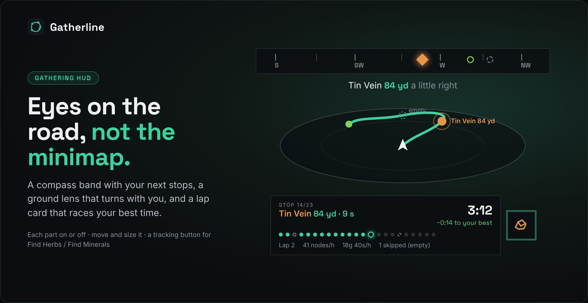
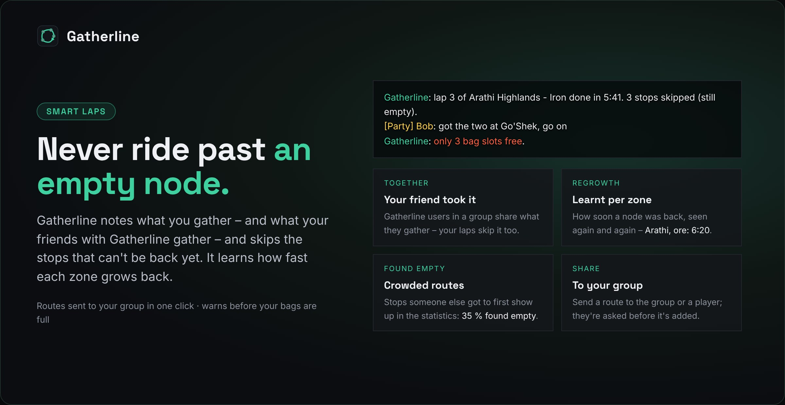
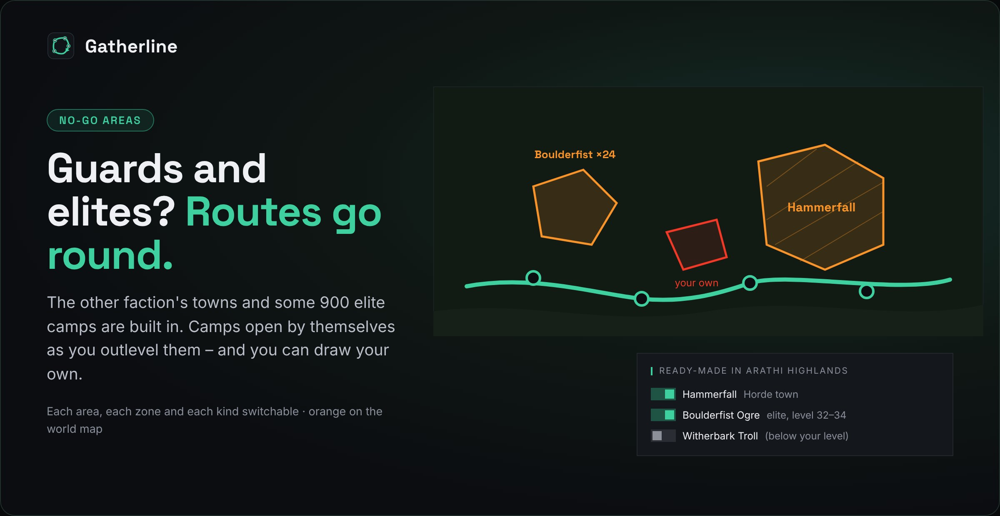
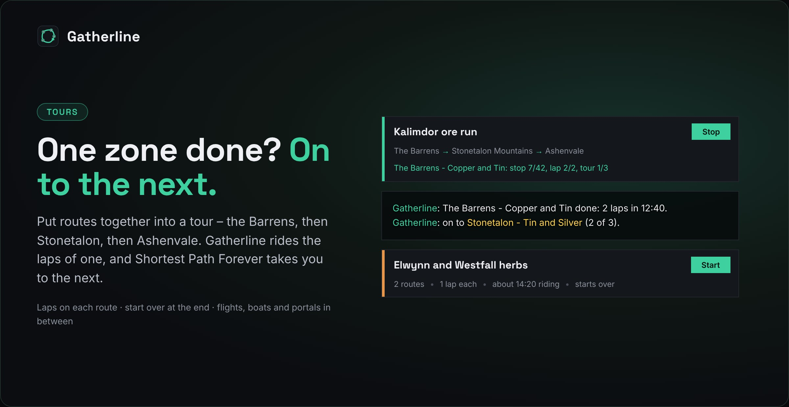
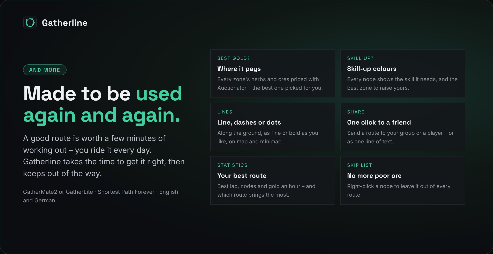

## Gathering routes over the real ground

**Gatherline** turns the herb and ore nodes from **GatherMate2** or **GatherLite** into the shortest gathering loop – measured on foot over the real terrain, drawn on your world map and minimap, and ridden with an arrow that leads you round it.

- **Over the ground, not through it:** routes are measured on the game's own walking maps (from Shortest Path Forever) – round mountains, cliffs and lakes instead of straight over them
- **Never worse than a straight line:** five candidate loops are walked leg by leg and polished, and the shortest on foot wins
- **Lines along the ground:** the route on your map follows the way you actually ride
- **Passes within:** with Find Herbs or Find Minerals on, the route only comes close enough to see each node
- **Start:** ride any route with an arrow and tracker, from anywhere, lap after lap

Made for **World of Warcraft: Forever**.

## Every zone, every loop

Type `/gl`, pick a zone and what to gather – single nodes like *Peacebloom* or *Copper Vein*, or whole kinds – and Gatherline finds the loop. Every route shows its nodes, its length on foot and how long a lap takes. Give it its own colour, rename it, rebuild it when GatherMate2 or GatherLite know more, or turn it round with one click. **Skill up?** finds the best zone for your Herbalism or Mining, **Best gold?** the one whose nodes are worth the most at Auctionator's prices – each with the right nodes already picked.

In tests on the real walking maps, routes in mountainous zones like **Dun Morogh** and **Loch Modan** came out **20–29% shorter on foot** than straight-line routes. In flat zones the straight-line loop is often already the best – and then that's the one you get.

## Click Start. Just ride.

Click **Start** on a route and Shortest Path Forever's arrow and tracker take over:

- From **anywhere** – another zone, another continent – it leads you to the route first, with flights, boats and portals, then round the loop from the nearest stop.
- **Lap after lap**, or a set number of laps, with each lap's time in chat.
- Ride past a stop toward a later one and it simply carries on from there.
- **Statistics per route:** best and average lap, nodes an hour and – with Auctionator – gold an hour, right on the route's card.

## The gathering HUD

Eyes on the road, not the minimap – three parts, each switched on or off, moved, sized and faded to your liking:

- **Compass band:** the way you face, the stop you head for as a diamond, the next ones numbered, empty ones hollow – with the stop's name, how far and which way.
- **Ground lens:** a tilted disc round you that turns with you, showing the route's line along the ground and the stops on it.
- **Lap card:** the next stop in yards and seconds, a dot for every stop of the lap, and your lap time racing your best.
- **Tracking button:** shows whether the next stop needs Find Herbs or Find Minerals and switches with one click (or a key of your own).

## Never ride past an empty node

- **Smart laps:** stops whose nodes you just gathered are skipped until they can be back.
- **Gather together:** friends with Gatherline in your group share what they gather – your laps skip what they just took. Send each other routes in one click.
- **Regrowth learnt:** Gatherline sees how soon nodes come back in each zone and skips stops no longer than that.
- **Found empty:** stops someone else got to first show in the route's statistics, so you see which routes are crowded.
- **Bags-full warning** before there's no room left.

## Guards and elites? Routes go round.

- **Hostile towns:** the other faction's towns are built in – your routes keep out of them.
- **Elite camps:** some 900 places where elites, rare elites and bosses stand, with their levels. They open by themselves as you outlevel them.
- **Your own no-go areas:** draw any part of a zone on the world map.
- Each area, each zone and each kind can be switched on or off.

## One zone done? On to the next.

Put routes together into a **tour** – the Barrens, then Stonetalon, then Ashenvale. Gatherline rides the laps of one route, and Shortest Path Forever takes you to the next, flights, boats and portals included. Set the laps on each route and whether the tour starts over at the end.

## Your pace, your stops

The **Guidance** page decides how the ride feels:

- **Next stop when this close:** move on to the next stop 15 to 150 yards before you reach it
- **Stops shown ahead:** how many numbered stops the map and tracker show
- **Stop names:** *Stop 3/42*, what's there – *Copper Vein ×2, Tin Vein* – or both
- **Arrows** along every route, and a **line to the route** on the minimap
- **Lines** as a solid line, dashes or dots, as fine or bold as you like

## And more

- **New nodes join by themselves** wherever they add the least walking
- **Share routes:** to your group, to a player, or as one line of text
- **Your best route:** see which route brings the most gold or nodes an hour
- **Skip list:** right-click poor or wilted nodes to leave them out everywhere
- **Works with GatherMate2 and GatherLite**, including GatherLite's built-in WoW Forever node database
- **Coming from GatherPath Forever?** Your routes come over by themselves
- **English and German**, following your game client

## Requirements

| Addon | What for | |
|---|---|---|
| **GatherMate2** or **GatherLite** | The nodes routes are made from – either one, or both (a node both know counts once) | one of them required |
| **Shortest Path Forever** (with **ForeverCore**) | Walking maps for routes over the ground, the guidance for Start, tours and the HUD | **yes** – installed with Gatherline by the CurseForge app (without it, routes use straight lines and there's no Start, guidance or HUD) |
| **Auctionator** | Gold an hour in the statistics, and *Best gold?* | optional |

The **About** page in the window shows whether everything is there.

## Commands

| Command | What it does |
|---|---|
| `/gl` | Open the window |
| `/gl new` | Make a new route |
| `/gl start`, `/gl stop` | Ride the route shown in your zone / stop |
| `/gl tour [name]` | Ride a tour |
| `/gl reverse` | Turn the route round |
| `/gl laps N` | Laps to ride (0 = until you stop) |
| `/gl reach N` | How close (yards) before the next stop |
| `/gl names number\|nodes\|both` | What stops are called |
| `/gl show`, `/gl hide` | Show or hide all lines |
| `/gl hud [compass\|lens\|card\|preview]` | The gathering HUD: all, one part, or a preview |
| `/gl empty N` | Minutes a gathered stop is skipped (0 = never) |
| `/gl regrowth` | How soon nodes grew back, per zone |
| `/gl stats`, `/gl stats all` | Statistics of the route you ride / all routes, best first |
| `/gl skill` | Where to skill up |
| `/gl share`, `/gl import` | Share a route / add a shared one |
| `/gl skipped` | Nodes on your skip list |

## Good to know

Working out a route takes a moment – for a big zone with hundreds of nodes a few minutes. Gatherline takes the time because a good route is one you ride again and again; the game keeps running smoothly meanwhile, and you can watch the progress on the route's card.

## Credits

Gatherline grew out of **GatherPath Forever** by severd8 (MIT) and uses the walking search of **Shortest Path Forever** by cjber (GPL-3.0); hostile towns come from its data too. Skill data for herbs and ores from **GatherLite** by Wuild (MIT). Elite camps and what nodes yield from the **CMaNGOS Classic database** (GPL-3.0). Licensed under GPL-3.0 – source on [GitHub](https://github.com/Drakner-chio/Gatherline).
