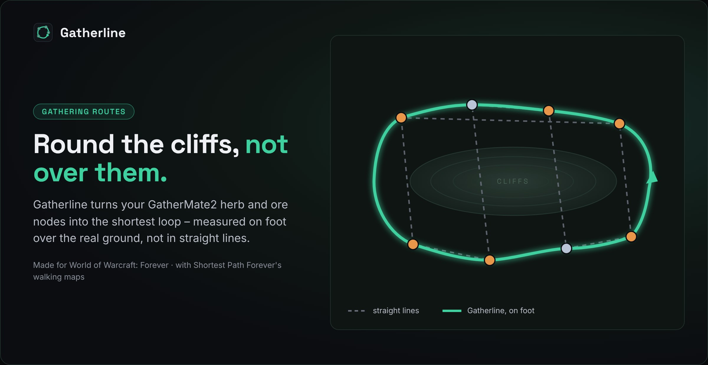
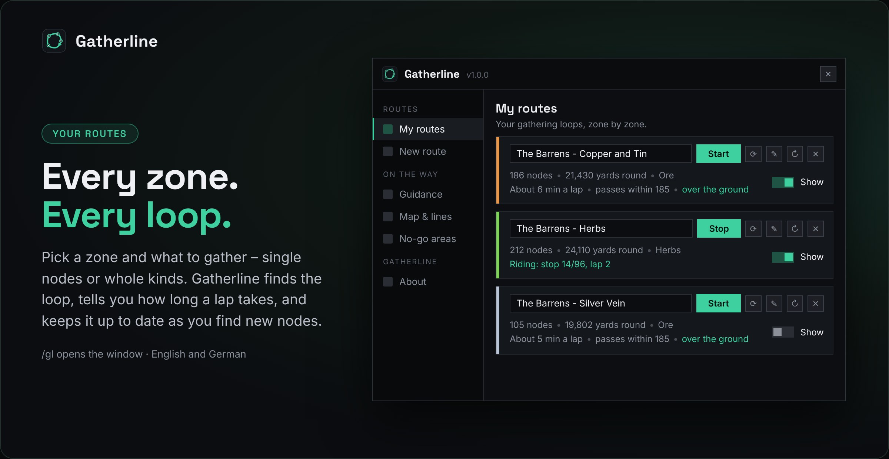
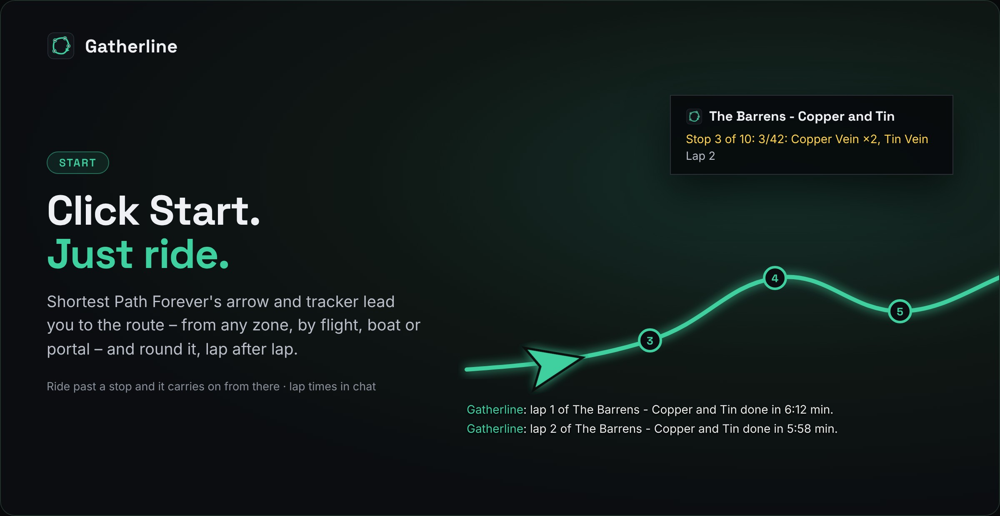
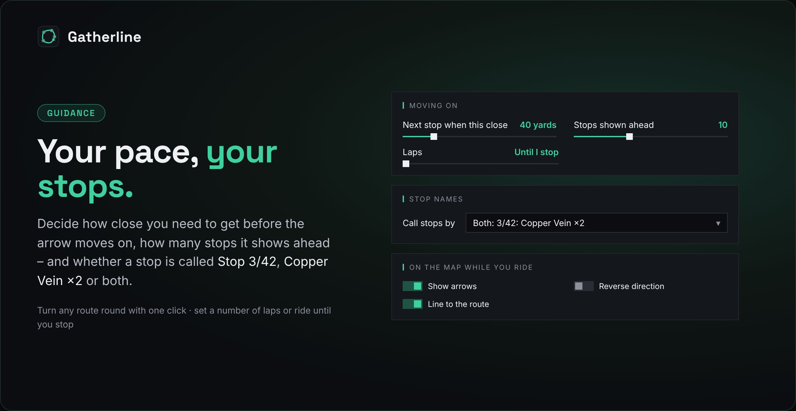

## Gathering routes over the real ground

**Gatherline** turns the herb and ore nodes from **GatherMate2** or **GatherLite** into the shortest gathering loop – measured on foot over the real terrain, drawn on your world map and minimap, and ridden with an arrow that leads you round it.

- **Over the ground, not through it:** routes are measured on the game's own walking maps (from Shortest Path Forever) – round mountains, cliffs and lakes instead of straight over them
- **Never worse than a straight line:** five candidate loops are walked leg by leg and polished, and the shortest on foot wins
- **Lines along the ground:** the route on your map follows the way you actually ride
- **Passes within:** with Find Herbs or Find Minerals on, the route only comes close enough to see each node
- **Start:** ride any route with an arrow and tracker, from anywhere, lap after lap

Made for **World of Warcraft: Forever**.

## Every zone, every loop

Type `/gl`, pick a zone and what to gather – single nodes like *Peacebloom* or *Copper Vein*, or whole kinds – and Gatherline finds the loop. Every route shows its nodes, its length on foot and how long a lap takes. Give it its own colour, rename it, rebuild it when GatherMate2 knows more, or turn it round with one click.

In tests on the real walking maps, routes in mountainous zones like **Dun Morogh** and **Loch Modan** came out **20–29% shorter on foot** than straight-line routes. In flat zones the straight-line loop is often already the best – and then that's the one you get.

## Click Start. Just ride.

Click **Start** on a route and Shortest Path Forever's arrow and tracker take over:

- From **anywhere** – another zone, another continent – it leads you to the route first, with flights, boats and portals, then round the loop from the nearest stop.
- **Lap after lap**, or a set number of laps, with each lap's time in chat.
- Ride past a stop toward a later one and it simply carries on from there.
- **Smart laps:** stops whose nodes you gathered a few minutes ago are skipped until they can be back – no more riding past empty spots.
- **Statistics per route:** best and average lap, nodes an hour and – with Auctionator – gold an hour, right on the route's card.

## Your pace, your stops

The **Guidance** page decides how the ride feels:

- **Next stop when this close:** move on to the next stop 15 to 150 yards before you reach it
- **Stops shown ahead:** how many numbered stops the map and tracker show
- **Stop names:** *Stop 3/42*, what's there – *Copper Vein ×2, Tin Vein* – or both
- **Arrows** along every route, and a **line to the route** on the minimap

## And more

- **No-go areas:** draw parts of a zone on the world map that your routes keep out of
- **New nodes join by themselves** wherever they add the least walking
- **Gather together:** friends with Gatherline share what they gather – your laps skip what they just took – and send each other routes in one click
- **Learns regrowth** per zone and shows how often a route's stops were already picked clean
- **Ready-made no-go areas:** routes keep out of hostile towns and elite camps above your level – no drawing needed, each one switchable
- **Gathering HUD:** a compass band with your next stops, a ground lens that turns with you, and a lap card with your time against your best – switch on what you like, place it where you like
- **Tours over several zones:** the Barrens, then Stonetalon, then Ashenvale – Gatherline rides your routes one after the other and Shortest Path takes you from zone to zone
- **Skill up smarter:** every node shows the skill it needs in skill-up colours, and *Where to skill up* finds the best zone for your Herbalism or Mining – with the right nodes already picked
- **Share routes:** one line of text, and your friends ride exactly your loop
- **Your best route:** see which route brings the most gold or nodes an hour
- **Skip list:** right-click poor or wilted nodes to leave them out everywhere
- **Works with GatherMate2 and GatherLite**, including GatherLite's built-in WoW Forever node database
- **Coming from GatherPath Forever?** Your routes come over by themselves
- **English and German**, following your game client

## Requirements

| Addon | What for | |
|---|---|---|
| **GatherMate2** or **GatherLite** | The nodes routes are made from – either one, or both (a node both know counts once) | one of them required |
| **Shortest Path Forever** (with **ForeverCore**) | Walking maps for routes over the ground, the guidance for Start, tours and the HUD | **yes** – installed with Gatherline by the CurseForge app (without it, routes use straight lines and there's no Start, guidance or HUD) |
| **Auctionator** | What your loot is worth, for gold an hour in the statistics | optional |

The **About** page in the window shows whether everything is there.

## Commands

| Command | What it does |
|---|---|
| `/gl` | Open the window |
| `/gl new` | Make a new route |
| `/gl start`, `/gl stop` | Ride the route shown in your zone / stop |
| `/gl reverse` | Turn the route round |
| `/gl laps N` | Laps to ride (0 = until you stop) |
| `/gl reach N` | How close (yards) before the next stop |
| `/gl names number\|nodes\|both` | What stops are called |
| `/gl show`, `/gl hide` | Show or hide all lines |
| `/gl skipped` | Nodes on your skip list |
| `/gl empty N` | Minutes a gathered stop is skipped (0 = never) |
| `/gl stats` | Statistics of the route you ride |
| `/gl stats all` | All your routes, best first |
| `/gl tour [name]` | Ride a tour |
| `/gl hud` | The gathering HUD on or off |
| `/gl skill` | Where to skill up |
| `/gl share`, `/gl import` | Share a route / add a shared one |

## Good to know

Working out a route takes a moment – for a big zone with hundreds of nodes a few minutes. Gatherline takes the time because a good route is one you ride again and again; the game keeps running smoothly meanwhile, and you can watch the progress on the route's card.

## Credits

Gatherline grew out of **GatherPath Forever** by severd8 (MIT) and uses the walking search of **Shortest Path Forever** by cjber (GPL-3.0). Skill data for herbs and ores from **GatherLite** by Wuild (MIT). Elite camps from the **CMaNGOS Classic database** (GPL-3.0). Licensed under GPL-3.0 – source on [GitHub](https://github.com/Drakner-chio/Gatherline).
